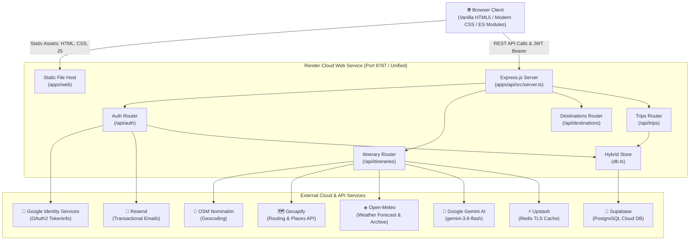
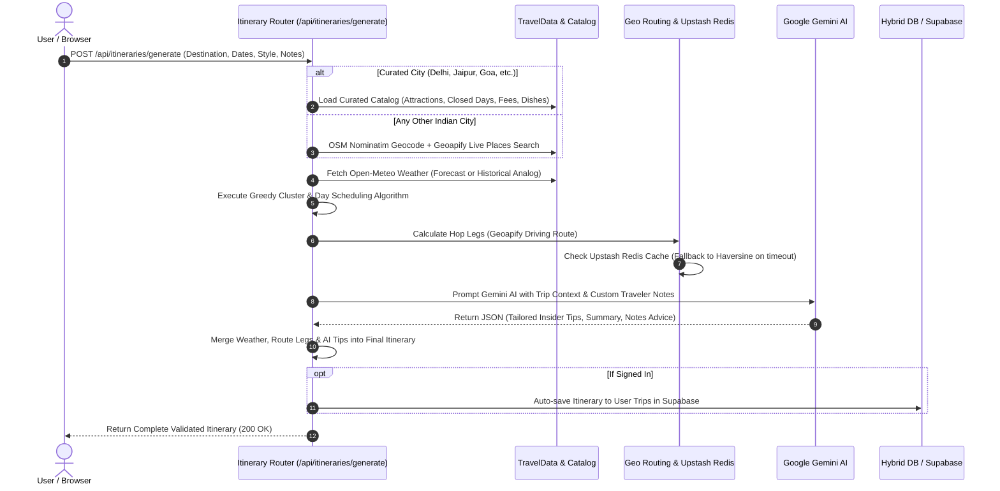
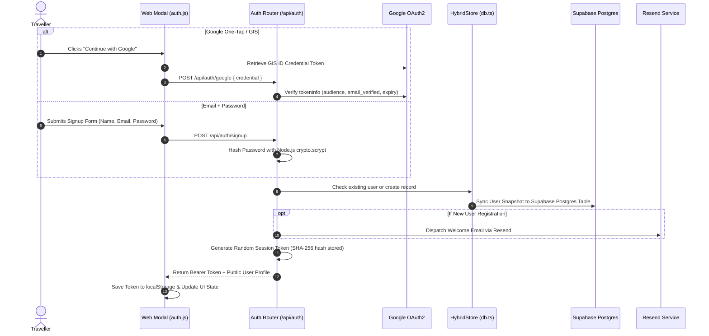

# ✈️ YatraAI — India Travel Planner

[](https://nodejs.org/)
[](https://www.typescriptlang.org/)
[](https://expressjs.com/)
[](https://aistudio.google.com/)
[](https://supabase.com/)
[](https://upstash.com/)
[](https://leafletjs.com/)
[](https://render.com/)

An AI-powered travel planner and itinerary engine designed exclusively for India. It crafts realistic, multi-day journeys combining cultural heritage, geo-optimized routing, daily weather forecasting, localized culinary stops, live road travel times, and Google Gemini AI personalization.

**Live Application**: [https://ai-travel-planner-6es8.onrender.com/](https://ai-travel-planner-6es8.onrender.com/)

---

## 📋 Table of Contents

1. [Key Features](#-key-features)
2. [System Architecture](#-system-architecture)
3. [Itinerary Generation & AI Flow](#-itinerary-generation--ai-flow)
4. [Authentication & Persistence Flow](#-authentication--persistence-flow)
5. [Repository Structure](#-repository-structure)
6. [Detailed File-by-File Breakdown](#-detailed-file-by-file-breakdown)
7. [Environment Variables Reference](#-environment-variables-reference)
8. [Getting Started (Local Development)](#-getting-started-local-development)
9. [Production Deployment (Render)](#-production-deployment-render)
10. [REST API Endpoints](#-rest-api-endpoints)

---

## 🌟 Key Features

- **Dual-Tier Location Engine**:
  - **Curated Guides (9 Destinations)**: In-depth offline guides for *Delhi, Agra, Jaipur, Varanasi, Mumbai, Goa, Kerala, Himachal Pradesh (Shimla/Manali), and Udaipur* with verified ASI monument ticket prices, opening hours, weekly closures (e.g., Taj Mahal on Fridays), signature regional dishes, and festival calendars.
  - **Live Dynamic Engine (Any Indian City/Town)**: Accepts any arbitrary location across India (e.g., *Shillong, Ooty, Rishikesh, Hampi, Pondicherry, Amritsar, Ladakh*), geocoding via OpenStreetMap Nominatim and fetching live attractions, restaurants, and stays via Geoapify Places API.
- **AI Personalization (Google Gemini 3.6 Flash)**:
  - Takes raw traveler preferences and custom free-text notes (e.g., *"travelling with toddlers", "strictly vegetarian", "senior citizens with slow pace"*) and generates targeted insider tips, tailored trip summaries, and contextual advice.
- **Real Road Distance & Duration Routing**:
  - Replaces crude straight-line math with **Geoapify Routing API** for true driving distances, speeds, and traffic times across Indian roads, cached in Upstash Redis (7-day TTL) for sub-millisecond retrieval.
- **Interactive Multi-Day Visual Canvas**:
  - Day-by-day Leaflet & OpenStreetMap interactive routes with numbered stops, hotels, and restaurant markers.
  - Single-click **"Day route in Google Maps"** navigation links.
  - Interactive itinerary editor: cross-day stop reordering, attraction replacement modal with live search, restaurant swaps, and hotel tier upgrades.
- **INR Cost Estimation & Budget Tracking**:
  - Detailed budget breakdown across 6 categories: Accommodation, Food & Dining, Local Transport, Sightseeing & Entry Tickets, Activities, and Miscellaneous.
  - Compares user budgets against Budget, Mid-range, and Premium travel styles.
- **Complete Auth & Hybrid Cloud Persistence**:
  - Email/Password auth with scrypt password hashing + Google Identity Services (GIS) One-Tap login.
  - Hybrid Database: Instant in-memory reads, atomic local disk writes, and automatic background synchronization to **Supabase PostgreSQL**.
- **Transactional Emails**:
  - Automated welcome emails on signup powered by **Resend**.

---

## 🏗️ System Architecture



---

## ⚡ Itinerary Generation & AI Flow



---

## 🔐 Authentication & Persistence Flow



---

## 📂 Repository Structure

```text
AI-Travel-Planner/
├── .env.example                       # Template for all environment variables
├── .gitignore                         # Git exclusion rules (ignores .env, build artifacts, db files)
├── README.md                          # Project documentation, guides, and architecture
├── package.json                       # Monorepo root workspace configuration & npm scripts
├── render.yaml                        # Render Cloud Infrastructure as Code (IaC) blueprint
├── scripts/
│   └── serve-web-source.mjs           # Local standalone dev proxy server (port 5173 -> 8787)
├── packages/
│   └── shared/                        # Shared TypeScript types and Zod validation schemas
│       ├── package.json
│       ├── tsconfig.json
│       └── src/
│           ├── index.ts               # Shared package barrel export
│           ├── account.ts             # User account, auth, and trip persistence schemas
│           └── itinerary.ts           # Complete itinerary, activity, cost & preferences schemas
└── apps/
    ├── api/                           # Backend Express REST API server
    │   ├── package.json
    │   ├── tsconfig.json
    │   └── src/
    │       ├── server.ts              # Express initialization, static asset mounting, error handling
    │       ├── auth/
    │       │   └── auth.ts            # Scrypt password hashing, session tokens, Google verification
    │       ├── config/
    │       │   ├── providers.ts       # External provider validation (Geoapify, Nominatim)
    │       │   └── runtimeEnv.ts      # Startup diagnostics & environment variable warnings
    │       ├── data/
    │       │   ├── catalog.ts         # In-memory registry for all 9 curated destination guides
    │       │   ├── types.ts           # Domain models for catalog attractions, hotels, and seasons
    │       │   └── destinations/      # Hand-curated destination guides
    │       │       ├── agra.ts
    │       │       ├── delhi.ts
    │       │       ├── goa.ts
    │       │       ├── himachal.ts
    │       │       ├── jaipur.ts
    │       │       ├── kerala.ts
    │       │       ├── mumbai.ts
    │       │       ├── udaipur.ts
    │       │       └── varanasi.ts
    │       ├── routes/
    │       │   ├── auth.ts            # /api/auth endpoints (signup, login, google, session)
    │       │   ├── destinations.ts    # /api/destinations endpoints (catalog guides & summaries)
    │       │   ├── handle.ts          # Async route wrapper for standardized Express error catching
    │       │   ├── itineraries.ts     # /api/itineraries endpoints (generate & live customize)
    │       │   └── trips.ts           # /api/trips endpoints (CRUD for saved user journeys)
    │       ├── services/
    │       │   ├── ai.ts              # Google Gemini 3.6 Flash personalization service
    │       │   ├── buildDemoItinerary.ts # Fallback demo builder for quick smoke tests
    │       │   ├── buildTripItinerary.ts # Master itinerary orchestration pipeline
    │       │   ├── email.ts           # Resend transactional email integration (welcome & reset)
    │       │   ├── geo.ts             # Geoapify routing client, haversine math, and Redis cache
    │       │   ├── planner.ts         # Core heuristic day-scheduling & greedy clustering engine
    │       │   └── travelData.ts      # Nominatim geocoding, Open-Meteo weather & Geoapify places
    │       └── store/
    │           ├── db.ts              # HybridStore combining memory, local JSON and cloud sync
    │           ├── redis.ts           # Upstash Redis TLS client initialization
    │           └── supabase.ts        # Supabase PostgreSQL client and sync layer
    └── web/                           # Frontend Single Page Application (SPA)
        ├── package.json
        ├── index.html                 # HTML shell, Leaflet CDN imports, ambient lighting glows
        ├── style.css                  # Custom Vanilla CSS design system (dark glassmorphism, responsive)
        ├── app.js                     # Client router, hash-based navigation, global app bootstrap
        └── js/
            ├── api.js                 # Fetch wrapper with Bearer token injection and error handling
            ├── map.js                 # Leaflet map manager, route polylines, markers and popups
            ├── state.js               # Reactive client state management (user, token, destinations)
            ├── ui.js                  # Formatting helpers, INR currency, toast alerts, loading modal
            └── views/
                ├── auth.js            # Login & signup modal with Google Identity Services button
                ├── dashboard.js       # "My Trips" dashboard (saved journeys list, notes, delete)
                ├── destination.js     # Curated guide view (attraction catalog, food, season, map)
                ├── home.js            # Explore page (hero banner, search suggestions, destination cards)
                ├── plan.js            # Trip briefing form (dates, length, style, pace, custom notes)
                └── trip.js            # Interactive itinerary canvas (stop reordering, modal picker, map)
```

---

## 🔍 Detailed File-by-File Breakdown

### Root Directory

| File | Description |
| :--- | :--- |
| `package.json` | Root monorepo configuration using npm workspaces (`apps/*`, `packages/*`). Defines lifecycle scripts (`build`, `dev`, `start`, `typecheck`). Specifies Node `>=20.0.0` engine. |
| `render.yaml` | Infrastructure as Code (IaC) blueprint for Render Cloud. Configures build command, health check endpoint (`/health`), and environment variable bindings. |
| `.env.example` | Exhaustive environment variable template listing all API keys, ports, and configuration switches with documentation comments. |
| `.gitignore` | Prevents sensitive credentials (`.env`), build directories (`dist/`, `build/`), caches, and local databases (`apps/api/data/`) from reaching version control. |
| `README.md` | Primary developer documentation, architecture overview, and onboarding guide. |
| `scripts/serve-web-source.mjs` | Standalone Node.js HTTP server used for local development. Serves frontend source files on port `5173` and proxies `/api` and `/health` requests to port `8787`. |

---

### Shared Package (`packages/shared/`)

| File | Description |
| :--- | :--- |
| `package.json` | Manifest for the `@ai-travel-planner/shared` package. Exports TypeScript type definitions and transpiled CommonJS/ESM schemas. |
| `tsconfig.json` | TypeScript compiler configuration emitting declarations (`.d.ts`) to `dist/`. |
| `src/index.ts` | Barrel export re-exporting all schemas and TypeScript types for consumers. |
| `src/account.ts` | Zod validation schemas and types for user authentication (`SignupRequest`, `LoginRequest`, `GoogleLoginRequest`, `PublicUser`) and saved trip persistence (`SavedTrip`, `SaveTripRequest`, `UpdateTripRequest`). |
| `src/itinerary.ts` | Core schema definitions for the entire travel planner: `TravelPreferences`, `Itinerary`, `TripDay`, `TripActivity`, `TravelLeg`, `TripWeather`, `Hotel`, `CostBreakdown`, and `CustomizeOperation`. |

---

### Backend API (`apps/api/`)

#### Server & Config

| File | Description |
| :--- | :--- |
| `package.json` | Manifest for `@ai-travel-planner/api`. Lists runtime dependencies (`express`, `@google/genai`, `@supabase/supabase-js`, `ioredis`, `resend`, `cors`, `zod`). |
| `tsconfig.json` | Configures TypeScript compilation to `dist/` using NodeNext module resolution. |
| `src/server.ts` | Main Express server entry point. Sets up `trust proxy: 1` for Render, mounts CORS and JSON parsers, routes API endpoints, serves `apps/web` statically for single-port production hosting, and serves `/health` and `/api/config`. |
| `src/config/providers.ts` | Inspects environment variables to determine active providers for geocoding (Nominatim), routing (Geoapify/Haversine), and places. |
| `src/config/runtimeEnv.ts` | Validates environment configurations at startup and produces warning diagnostics if keys (Gemini, Geoapify, Resend, Google) are omitted. |

#### Authentication & Database Store

| File | Description |
| :--- | :--- |
| `src/auth/auth.ts` | Implements authentication security: password hashing with Node's native `crypto.scrypt`, secure random session tokens (stored as SHA-256 hashes), in-memory IP rate limiting, Express auth middleware (`requireAuth`, `optionalAuth`), and Google OAuth tokeninfo verification (`verifyGoogleCredential`). |
| `src/store/db.ts` | `HybridStore` database abstraction. Maintains an in-memory database cache for zero-latency lookups, writes mutations atomically to local JSON (`data/db.json`), and synchronizes rows to Supabase PostgreSQL. |
| `src/store/supabase.ts` | Connects to Supabase using `@supabase/supabase-js`. Hydrates users, sessions, and trips from cloud PostgreSQL on server boot and mirrors local store mutations. |
| `src/store/redis.ts` | Initializes an Upstash Redis client with TLS (`ioredis`). Manages route caching and distributed rate limiting with automatic reconnect and fallback. |

#### Services & Intelligence Layer

| File | Description |
| :--- | :--- |
| `src/services/ai.ts` | Google Gemini AI integration (`@google/genai`). Reads traveler preferences, paces, interests, and free-form notes to generate tailored insider tips, personalized trip summaries, and special considerations. |
| `src/services/geo.ts` | Geospatial computation service. Computes Haversine distances, centroid coordinates, and queries Geoapify Routing API for real road travel times. Implements dual-layer caching (in-memory Map + 7-day Upstash Redis). |
| `src/services/email.ts` | Transactional email engine using Resend. Dispatches branded HTML welcome emails on signup and password reset links with dynamic application URLs. |
| `src/services/travelData.ts` | Dynamic location resolver for non-catalog Indian destinations. Geocodes via OpenStreetMap Nominatim, retrieves live forecasts and historical weather from Open-Meteo, and discovers live attractions, cafes, and hotels via Geoapify. |
| `src/services/planner.ts` | Comprehensive algorithmic itinerary builder. Clusters attractions geographically to minimize travel time, schedules morning/afternoon/sunset slots, injects lunch/dinner near active stops, and respects monument closing days. |
| `src/services/buildTripItinerary.ts` | Master pipeline controller. Resolves data source (curated catalog vs. live dynamic), gathers weather, triggers algorithmic planning, enriches legs with Geoapify routing, runs Gemini AI personalization, and validates schemas. |
| `src/services/buildDemoItinerary.ts` | Lightweight demo generator used for quick integration testing and deterministic fixtures. |

#### Routes

| File | Description |
| :--- | :--- |
| `src/routes/handle.ts` | High-order wrapper for Express async route handlers. Intercepts unhandled Promise rejections and forwards them to Express error middleware. |
| `src/routes/auth.ts` | REST endpoints for user authentication: `/signup`, `/login`, `/google`, `/logout`, `/me`, and `/me/recent`. |
| `src/routes/destinations.ts` | Serves destination catalog metadata, city guides, seasonal information, and pre-calculated 3/4/5/7-day budget estimates via `/api/destinations`. |
| `src/routes/itineraries.ts` | Endpoints for itinerary creation: `POST /generate` (generates and auto-saves itineraries) and `POST /customize` (re-routes after stops are removed, moved, added, or meals swapped). |
| `src/routes/trips.ts` | Authenticated CRUD endpoints for saved traveler itineraries: list, read, update title/notes, duplicate, and delete trips. |

#### Destination Catalogs (`apps/api/src/data/`)

| File | Description |
| :--- | :--- |
| `types.ts` | TypeScript domain types for destination catalogs (`Attraction`, `Restaurant`, `CatalogHotel`, `SeasonInfo`, `Dish`, `Destination`). |
| `catalog.ts` | Catalog registry indexing the 9 curated destinations with fuzzy alias lookups. |
| `destinations/agra.ts` | Curated guide for Agra: Taj Mahal (closed Fridays), Agra Fort, Fatehpur Sikri, Mehtab Bagh, Petha sweet shops, Mughlai dining. |
| `destinations/delhi.ts` | Curated guide for Delhi: Red Fort, Qutub Minar, Humayun's Tomb, Chandni Chowk food walk, Hauz Khas Village, Lodhi Art District. |
| `destinations/goa.ts` | Curated guide for Goa: North & South Goa beach hubs, Old Goa churches, Dudhsagar falls, spice plantations, Goan fish curry shacks. |
| `destinations/himachal.ts`| Multi-base mountain guide for Shimla & Manali: Mall Road, Solang Valley, Rohtang Pass, Old Manali cafes, local Siddu. |
| `destinations/jaipur.ts` | Curated guide for Jaipur (Pink City): Amber Fort, Hawa Mahal, City Palace, Nahargarh sunset, Dal Baati Churma restaurants. |
| `destinations/kerala.ts` | Multi-base coastal/hill guide: Fort Kochi heritage, Munnar tea estates, Alleppey backwater houseboats, Sadya feasts. |
| `destinations/mumbai.ts` | Curated guide for Mumbai: Gateway of India, Marine Drive, Elephanta Caves, Kala Ghoda art district, street food khau gallis. |
| `destinations/udaipur.ts` | Curated guide for Udaipur (City of Lakes): City Palace, Lake Pichola boat rides, Saheliyon-ki-Bari, lakeside rooftop dining. |
| `destinations/varanasi.ts`| Curated guide for Varanasi: Dashashwamedh Ghat Ganga Aarti, Kashi Vishwanath, sunrise boat rides, Sarnath Buddhist stupas. |

---

### Frontend Web App (`apps/web/`)

| File | Description |
| :--- | :--- |
| `index.html` | Application HTML shell. Preloads Cinzel & Plus Jakarta Sans typography, includes Leaflet mapping CSS/JS, renders ambient glow backdrops, navigation bar, and progress spinner overlays. |
| `style.css` | Comprehensive design system (3000+ lines). Features dark glassmorphism, responsive grid layouts, custom scrollbars, interactive cards, badge pills, animations, and tablet/mobile breakpoints. |
| `app.js` | Client-side micro-router. Monitors `window.location.hash`, manages active navigation states, handles global authentication checks, and mounts the active view. |
| `js/api.js` | Lightweight fetch client. Injects `Authorization: Bearer <token>` from localStorage, handles JSON body serialization, parses API errors, and manages session expiration. |
| `js/map.js` | Leaflet.js map controller. Initializes OpenStreetMap tile layers, renders custom color-coded day markers (attractions, stays, restaurants), and fits map bounds dynamically. |
| `js/state.js` | Client reactive state store. Manages logged-in user profiles, cached destination summaries, server configuration, and drafts. |
| `js/ui.js` | UI component utility toolkit: INR currency formatting (`₹`), date ranges, relative timestamps, toast notifications, loading modal progress bars, and Google Maps URL generators. |
| `js/views/auth.js` | Authentication modal dialog. Handles login, sign-up, form validation, and mounts the Google Identity Services "Continue with Google" button. |
| `js/views/dashboard.js` | "My Trips" dashboard. Lists all saved journeys, provides trip duplication, editing trip titles and notes, and deletion. |
| `js/views/destination.js` | Destination explorer view. Displays hero imagery, seasonal weather guides, must-try food cards, interactive Leaflet attraction maps, and pricing tables. |
| `js/views/home.js` | Landing page. Features a hero banner, fast-start search input, and interactive destination showcase cards with 3-day estimated budgets. |
| `js/views/plan.js` | Trip planner form. Collects destination (any Indian city with autocomplete suggestions), start dates, length segments, travel styles, pacing, and free-text custom requests. |
| `js/views/trip.js` | Interactive itinerary workspace. Displays day-by-day itineraries, Leaflet routes, cost summaries, AI tips, cross-day stop reordering, catalog place search modal, and restaurant swaps. |

---

## ⚙️ Environment Variables Reference

Create a `.env` file in the root directory by copying `.env.example`:

```bash
cp .env.example .env
```

| Variable | Required? | Default | Purpose / Where to Get It |
| :--- | :---: | :---: | :--- |
| `PORT` | Optional | `8787` | Port for the Express backend server (Render sets this automatically). |
| `WEB_PORT` | Optional | `5173` | Port for the local dev static file proxy server (`scripts/serve-web-source.mjs`). |
| `GEMINI_API_KEY` | Recommended | — | Google Gemini API key for personalized itinerary advice. Get free at [Google AI Studio](https://aistudio.google.com/). |
| `GEMINI_MODEL` | Optional | `gemini-3.6-flash` | Gemini model variant to utilize for generating tips and summaries. |
| `GEOAPIFY_API_KEY` | Recommended | — | Enables real road routing and live attraction/stay searches for unlisted cities. Free at [Geoapify](https://www.geoapify.com/). |
| `PLACES_PROVIDER` | Optional | `geoapify` | Provider for live places discovery (`geoapify` or fallback). |
| `ROUTING_PROVIDER` | Optional | `geoapify` | Provider for road travel times (`geoapify` or straight-line fallback). |
| `GEOCODING_PROVIDER`| Optional | `nominatim` | Geocoding service for Indian city coordinates (Nominatim requires no key). |
| `SUPABASE_URL` | Optional | — | Supabase project URL (`https://<id>.supabase.co`). Free at [Supabase](https://supabase.com/). |
| `SUPABASE_ANON_KEY` | Optional | — | Supabase public anonymous API key. |
| `SUPABASE_SERVICE_ROLE_KEY` | Optional | — | Supabase service role key for backend PostgreSQL synchronization. |
| `REDIS_URL` | Optional | — | Upstash Redis connection URI (`rediss://...`) for caching route calculations. Free at [Upstash](https://upstash.com/). |
| `RESEND_API_KEY` | Optional | — | Resend API key for sending welcome emails. Free at [Resend](https://resend.com/). |
| `EMAIL_FROM` | Optional | `onboarding@resend.dev` | Sender email address (use custom verified domain for production). |
| `GOOGLE_CLIENT_ID` | Optional | — | Google OAuth 2.0 Client ID for "Continue with Google" sign-in button. Obtain from [Google Cloud Console](https://console.cloud.google.com/). |
| `GOOGLE_CLIENT_SECRET` | Optional | — | Google OAuth 2.0 Client Secret (stored for secure server operations). |
| `RAPIDAPI_KEY` | Optional | — | Reserved for future live hotel and train availability queries via RapidAPI. |

---

## 🚀 Getting Started (Local Development)

### Prerequisites

- **Node.js**: `v20.0.0` or higher
- **npm**: `v10.0.0` or higher

### Installation & Run

1. **Clone the repository**:
   ```bash
   git clone https://github.com/kunal-masurkar/AI-Travel-Planner.git
   cd AI-Travel-Planner
   ```

2. **Install all workspace dependencies**:
   ```bash
   npm install
   ```

3. **Configure Environment**:
   ```bash
   cp .env.example .env
   # Open .env and add your GEMINI_API_KEY, GEOAPIFY_API_KEY, etc.
   ```

4. **Start the local development environment**:
   ```bash
   npm run dev
   ```

5. **Open in Browser**:
   - Web Application: [http://localhost:5173](http://localhost:5173)
   - API Health Check: [http://localhost:8787/health](http://localhost:8787/health)

---

## ☁️ Production Deployment (Render)

This repository is optimized for zero-configuration, single-service deployment on **Render**.

1. Create a new **Web Service** on [Render Dashboard](https://dashboard.render.com/).
2. Connect your GitHub repository.
3. Configure the service settings:
   - **Environment**: `Node`
   - **Build Command**: `npm install && npm run build`
   - **Start Command**: `npm start`
   - **Health Check Path**: `/health`
4. Add your environment variables from `.env` in the **Environment** tab.
5. In [Google Cloud Console](https://console.cloud.google.com/apis/credentials), add your Render URL (e.g., `https://ai-travel-planner-6es8.onrender.com`) to **Authorized JavaScript origins**.

---

## 📡 REST API Endpoints

### System & Configuration
- `GET /health`: Server status, environment warnings, and provider diagnostics.
- `GET /api/config`: Public client configurations (Google client ID, live-places status).

### Destination Catalog
- `GET /api/destinations`: List summaries and 3/4/5/7-day price estimates for all curated destinations.
- `GET /api/destinations/:key?travelers=2&startDate=YYYY-MM-DD`: Full guide for a specific destination.

### Itinerary Planning & Editing
- `POST /api/itineraries/generate`: Build a multi-day itinerary. Validates input, calculates routes, queries Gemini AI, and returns the plan. Automatically persists the trip if the user is authenticated.
- `POST /api/itineraries/customize`: Apply atomic modifications (`remove`, `move`, `moveDay`, `add`, `swapMeal`, `setHotel`) and recalculate daily times, distances, and costs.

### Authentication
- `POST /api/auth/signup`: Create a new email/password account (scrypt hashed).
- `POST /api/auth/login`: Authenticate an existing account and receive a bearer session token.
- `POST /api/auth/google`: Verify a Google Identity Services ID credential and login/register.
- `POST /api/auth/logout`: Revoke active session token.
- `GET /api/auth/me`: Fetch authenticated user profile.
- `POST /api/auth/me/recent`: Save recently viewed destinations to user history.

### Saved Trips (Requires `Authorization: Bearer <token>`)
- `GET /api/trips`: Fetch all saved itineraries for the authenticated traveler.
- `POST /api/trips`: Save an active itinerary to the user's account.
- `GET /api/trips/:id`: Retrieve a specific trip.
- `PUT /api/trips/:id`: Update trip title or notes.
- `DELETE /api/trips/:id`: Permanently remove a saved trip.
- `POST /api/trips/:id/duplicate`: Create an editable copy of an existing trip.

---

## 📄 License

This project is licensed under the [MIT License](LICENSE).
